# PGD-01 Portable Gaming Device

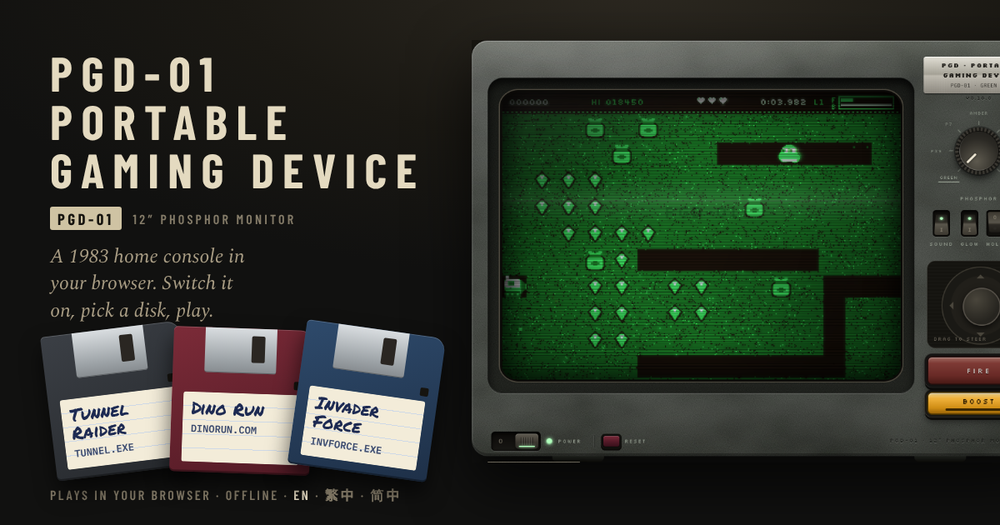

A 1983-style home console in the browser, on an old phosphor monitor. Switch it on, watch the BIOS and the floppy drive boot, pick a disk from the menu and play. Each game has its own loading screen, instructions and high-score table, and it all works offline once loaded.

| The disk menu | Loading Tunnel Raider | Tunnel Raider |
| --- | --- | --- |
| 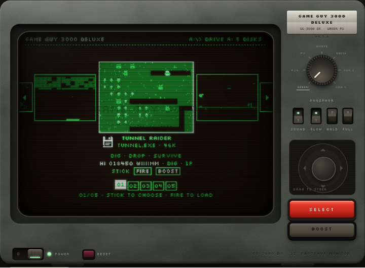 | 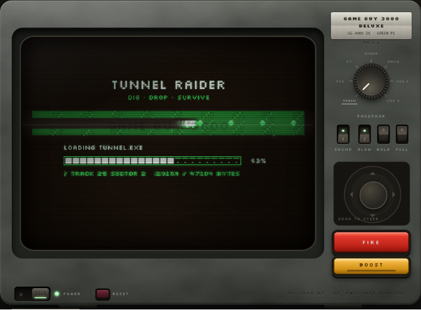 | 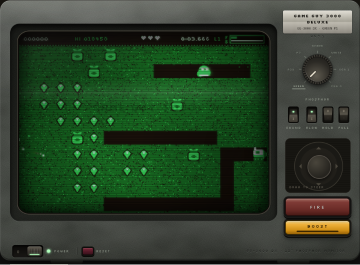 |
| **Loading Dino Run** | **Dino Run** | **Loading Invader Force** |
| 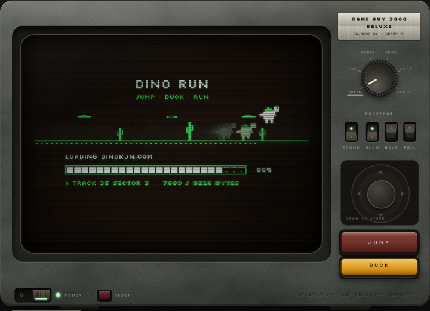 | 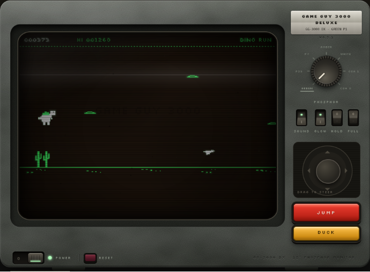 | 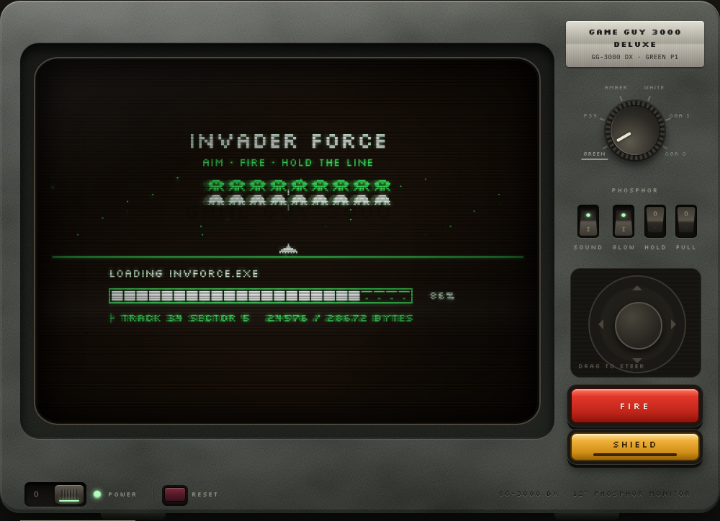 |
| **Invader Force** | **Loading I Invade** | **I Invade** |
| 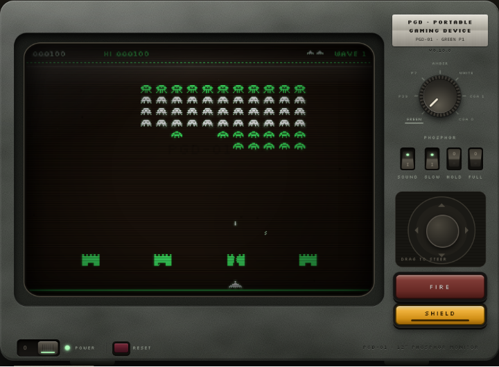 | 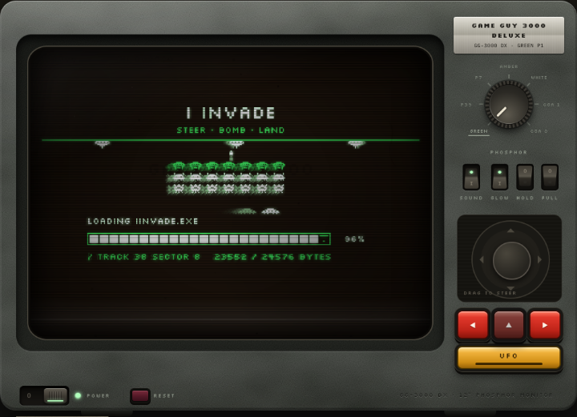 | 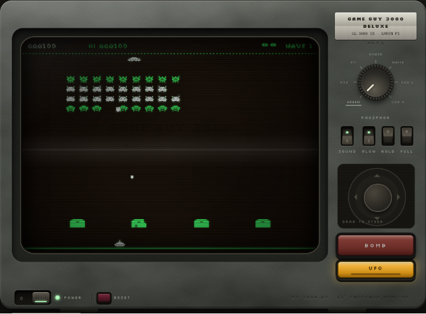 |
| **Loading Bricks** | **Bricks** | **Loading Martian Storm** |
| 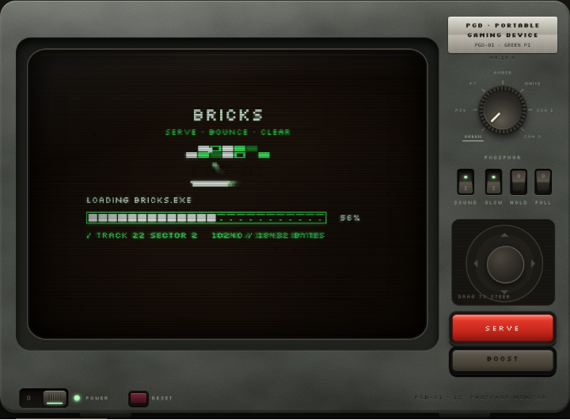 | 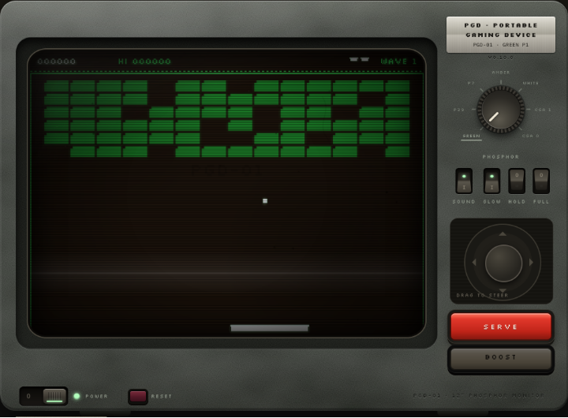 | 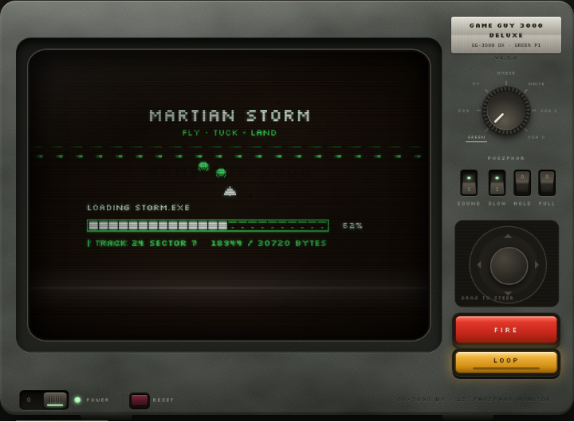 |
| **Martian Storm** | | |
| 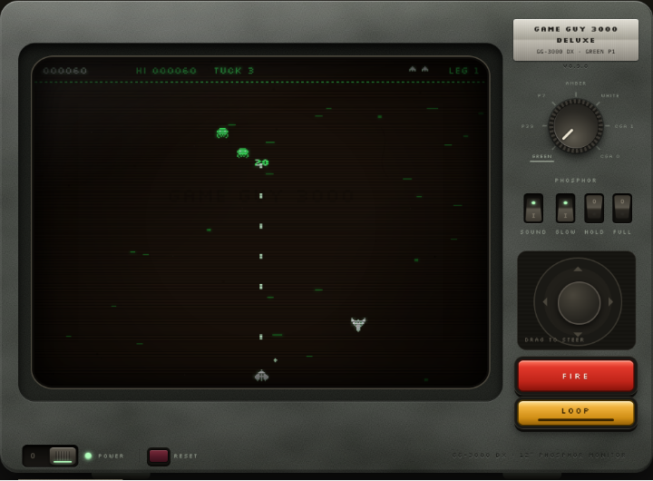 | | |

## Games

| # | Game | File | Load time | What it is |
| --- | --- | --- | --- | --- |
| 1 | **Tunnel Raider** | `TUNNEL.EXE` | 4.4 s | Dig for emeralds, drop sacks of gold on the grubs and outwit smarter monsters every level. A stage clock ticks on the top bar, and digging out every block of earth on a level wins a spare cart. A tribute to Windmill Software's *Digger* (1983). |
| 2 | **Dino Run** | `DINORUN.COM` | 1.8 s | Jump the cacti and boulders, duck the pterosaurs, run as far as you can. A tribute to the offline dinosaur game in Google Chrome (2014). |
| 3 | **Invader Force** | `INVFORCE.EXE` | 3.1 s | Hold the line against a marching alien formation: one shot at a time, walls that crumble, a mystery saucer, a short shield on BOOST, and capsules that drop weapons (Twin, Spread, Rapid, a lightning laser), a stacking shot-speed boost and a rare atomic bomb. A tribute to Taito's *Space Invaders* (1978). |
| 4 | **I Invade** | `IINVADE.EXE` | 2.6 s | The same war from the other side: the alien fleet marches up from the bottom of the screen on its own, and you time its left, middle and right bomb bays to hit the tanks along the top, with a cluster sweep, a UFO carpet and a meteor swarm to call on. One fleet a game; every tank has three lives, and the teams grow from one to six. Destroy them all or reach their row. |
| 5 | **Bricks** | `BRICKS.EXE` | 2.2 s | One bat and one ember. Serve it into a wall of clay, kiln, glass and cinder, and clear every breakable brick. Anvils stay. Broken bricks sometimes drop a capsule: Broad or Slim changes the bat, Flare or Damp the ember's speed, and Sear lets it through the next three breakable bricks. Up and down bow the bat. A miss loses a bat; three to start, another every 2,000, up to six. |
| 6 | **Martian Storm** | `STORM.EXE` | 3.8 s | Fly a skiff up through a Martian dust storm. Hold to shoot. BOOST spends a tuck: untouchable, guns silent, back where it started. Three tucks a leg, and a token can add one, up to five. Spores fly in fours; all four drop one token that cycles points, an extra tuck and twin guns. Barbs fire once. Slabs, from leg 3, take four hits and stop shots. Eight legs, then the pad. Three skiffs, another every 2,000, up to five. |

The characters, art, sound and code in all six are original.

Each game also has its own page that boots straight into its disk: `/tunnel-raider`, `/dino-run`, `/invader-force`, `/i-invade`, `/bricks` and `/martian-storm`, each with its own title, description and share image.

## The console

- **Nameplate:** PGD and the phosphor in use, with the release version stamped on its own line under the plate. The version is the one in `package.json`, so it moves with the release.
- **POWER** switches the set on (or press <kbd>Enter</kbd>). It runs a memory test, beeps, spins up the drive and boots the disk menu.
- **Disk menu (the cover carousel):** the front disk's cover sits in the middle with its title, blurb, best score, genre and controls under it, and its neighbours either side. A numbered tick strip and an `nn/NN` counter show where you are in the box.
  - **Choose a game:** stick or arrow keys (held, it repeats), a tap on a side cover, a tick or the ◀ ▶ arrows.
  - **Load it:** FIRE, <kbd>Space</kbd>, <kbd>Enter</kbd>, a tap on the front cover, or <kbd>1</kbd>–<kbd>9</kbd> for that disk.
  - **The old list:** add `?menu=list` to the address for the previous disk list, kept for one release.
- **Loading:** every disk shows a loading screen themed to its game and plays the drive (motor, head recalibrating, track steps, head parking) for exactly as long as it takes to read. Load times differ per game and never exceed 5 seconds.
- **<kbd>G</kbd>** warm-boots back to the disk menu from any game. (A SELECT key for this is built but hidden on the set for now.)
- **RESET** (wine-red key) restarts the whole console from the BIOS.
- **The phosphor dial and switches:**
  - **Dial:** green P1, long-afterglow green P39, radar P7 (a visible beam sweeping down the tube), amber P3, paper white P4 and the two CGA palettes.
  - **Switches:** SOUND, GLOW (all the tube effects), HOLD (pause) and FULL (full screen). HOLD switches itself on when you leave the tab or app mid-game, and stays on until you resume.
- **FIRE and BOOST** change with the game: FIRE and BOOST in Tunnel Raider, JUMP and DUCK in Dino Run, FIRE and SHIELD in Invader Force (SHIELD turns into NUKE while you hold an atomic bomb), BOMB and UFO in I Invade, SERVE in Bricks, where BOOST stays dark, and FIRE and LOOP in Martian Storm. LOOP spends one tuck per press. In Dino Run and Invader Force a tap on the screen works as JUMP or FIRE; in I Invade it fires the nearest bomb bay; in Bricks it serves, and does nothing while the ember is already in the air; in Martian Storm it shoots, and it does not tuck.
- **The button pad:** a game with no use for the stick (I Invade) swaps it for a pad of up to six buttons while it plays, and FIRE's row steps aside. In I Invade the top row is the left, middle and right bomb bays (◀ ▲ ▶, or <kbd>←</kbd> <kbd>↑</kbd> <kbd>→</kbd>, <kbd>Z</kbd> <kbd>X</kbd> <kbd>C</kbd>; <kbd>Space</kbd> is the middle bay too) and the bottom row the cluster sweep (<kbd>A</kbd>) and the meteor swarm (<kbd>S</kbd>, dimmed until charged); BOOST (<kbd>Shift</kbd>) calls the UFO. On the sideways console layout the three red bays move to the right with CLUSTER under them, and UFO sits above METEORS on the left; desk and the portrait layouts keep the two-row pad. The stick is back for the menu, loading, name entry and the high scores.
- **Instructions:** the printed leaflet under the set shows the console's instructions while the menu is up and the loaded game's while you play.
- **Settings:** the foot of the leaflet has **Reset settings** (green P1, SOUND and GLOW on, HOLD and FULL off, English) and, kept apart in wine red, **Clear high scores** (every game's table and best, and the saved name, on this device). Each asks before it acts.
- **Haptics:** on phones whose browser can vibrate (Chrome on Android, for one; Safari on iPhone and iPad can't), the set's controls tick when pressed (POWER, RESET, the four switches, each click of the dial, FIRE, BOOST, the extra fire keys and I Invade's button pad), a shot gives a short buzz, a catch in Invader Force a quick double buzz, and a lost life or the game's end a longer one. The stick gives a tiny nudge on each new direction. SOUND off keeps the phone still. Games call `api.buzz('fire' | 'pickup' | 'lose' | ms | pattern)`; the rules are in `src/kit/platform/haptics.ts`.

### High scores

Each game keeps its own top ten on the device, in the browser's local storage, so scores survive offline play and restarts but never leave the device.

- **Entering a name:** a score that makes the table opens arcade-style name entry: up to nine letters and spaces, picked from an on-screen grid with the stick and FIRE, tapped, or typed.
- **After a game:** the game-over card and the table take turns on the screen.
- **Moving over from Tunnel Raider:** scores saved by the standalone Tunnel Raider on the same site are picked up automatically.

## Screens

A layout detector picks a layout from the viewport and input type:

| Layout | When |
| --- | --- |
| Desk | A mouse or trackpad |
| Console | A phone held sideways (gamepad style) |
| Tall console | A tablet or opened foldable held sideways |
| Phone portrait | An upright phone |
| Tablet portrait | An upright tablet |

The playfield's grid follows the shape of the tube.

## Languages

English (default), Traditional Chinese and Simplified Chinese, carried in the link: `#en`, `#zh-hant` (also `#zh-hk`, `#zh-tw`), `#zh-hans` (also `#zh-cn`, `#zh-sg`). Text on the tube stays English in the pixel font.

## Development

**Astro** builds the pages as static HTML; **React** supplies the reusable parts of the set; the **console engine** is plain TypeScript on Canvas 2D. There's no game engine: the picture comes from the console's own four-colour, phosphor-afterglow CRT pass.

```sh
npm install
npm run dev        # local dev server
npm run build      # type-check, then build to dist/
npm run preview    # serve the build on http://localhost:4173
npm test           # unit tests (Vitest)
```

Browser checks use Playwright against `npm run preview`. They need Chromium and the `playwright` package; here the machine-wide copy is found with `NODE_PATH`:

```sh
npm run preview &
NODE_PATH=$(npm root -g) node tests/flow.cjs    # boot → menu → every disk (play, game over, name entry, back) plus Invader Force weapons, at three sizes
NODE_PATH=$(npm root -g) node tests/pages.cjs   # the leaflet follows game and language; game pages; offline play
NODE_PATH=$(npm root -g) node tests/stick.cjs   # the phone joystick steers, lets go, and never sticks when a release is lost
NODE_PATH=$(npm root -g) node tests/haptics.cjs # the set's controls and games buzz, SOUND off is silent, and the leaflet's reset and clear-scores work
```

Both scripts load pages with `?test`, which exposes a small `window.__gg` hook for driving the console.

### How it fits together

- **Pages** (`src/pages/`): `index.astro` is the console; `[slug].astro` makes one page per game from the disks. Both use `src/layouts/ConsoleLayout.astro`.
- **React components** (`src/components/`): the header, the set (`ConsoleSet`: `Screen`, `Nameplate`, `PhosphorDial`, `Rocker`, `PowerPanel`, `KeyButton`, `Joystick`, `ActionButtons`), the bar under it and the status badge. They render to static HTML at build time with the ids the engine looks for, so they ship no JavaScript.
- **The leaflet** (`Manual.tsx`) is the one live React island. It follows the engine's language and loaded game through a tiny shared store (`src/console/bus.ts`).
- **The console engine** (`src/console/`) runs the 60 fps loop:
  - **`core.ts`:** CRT picture, input, sound, switches, scores and the API games get.
  - **`loader.ts`:** boot screens, loading and drive sounds, and the launcher's wiring.
  - **`launcher/`:** the disk menu (cover carousel). DOM-free, so the native apps can run it: `state.ts` and `layout.ts` are pure and unit-tested, `draw.ts` paints through the console API, and `system.ts` is what it asks of the console.
  - **`i18n.ts`:** every string, in three languages.
  - **`pwa.ts`:** install button and offline and update prompts.
- **Games** (`src/games/`) plug in through `types.ts`. `registry.ts` finds them on its own.

```
src/pages/                 index.astro, [slug].astro
src/layouts/               ConsoleLayout.astro: head, layout detector, the set, the leaflet
src/components/            React components (static) and Manual.tsx (island)
src/console/               the engine: core, loader, i18n, strings, manual, bus, pwa
src/games/types.ts         the plug-in contract: GameDisk, GameRuntime, ConsoleAPI
src/games/registry.ts      finds the disks; fetches a game's code when it loads
src/games/<id>/disk.ts     a game's label, loading screen, instructions and strings
src/games/<id>/game.ts     the game itself: default export create(api)
src/styles/console.css     the set, its layouts and the leaflet
public/                    icons, favicon, share image
```

### Adding a game

Make a folder in `src/games/` with a `disk.ts` (the label, loading screen and instructions) and a `game.ts` (the game, default export `create(api)`). Nothing else needs editing: the disk menu, its page (`/<slug>`), its instructions, its high-score table and the offline cache all pick it up.

**[Making a game disk](src/games/README.md)** has the rest: every file a game needs in its folder and outside it, [which buttons a game uses and where they sit](src/games/README.md#controls-and-buttons), [how it shows up in the launcher and on its loading screen](src/games/README.md#on-the-menu-and-the-loading-screen), the artwork and images (sprites, loading screen, share image, screenshots and the launcher cover), the strings in three languages, the tests, the plug-in rules and a minimal example.

### Share images and screenshots

The share images (`public/og-image.png`, plus `public/og-<slug>.png` for each game's page) and the screenshots above (`docs/screens/`) are made from the real console by one script:

```sh
# each step runs only if the one before it worked, so a failed build never captures a stale dist/
npm run build &&
  { npm run preview & } &&   # serves http://localhost:4173
  until curl -sf http://localhost:4173 >/dev/null; do sleep 1; done &&   # wait for it to listen
  NODE_PATH=$(npm root -g) node tools/share-images/make.cjs
```

It switches the set on, captures the menu, each game's loading screen and some play (Dino Run on autopilot, caught mid-jump). It then lays each capture out beside the name and a fan of floppy disks (`tools/share-images/share.css`) at 1200 × 630.

- **Launcher covers:** add `--covers` to also write each game's cover for the disk launcher (`src/games/<folder>/cover.ts`) from the same moment as its play capture, or `--covers-only` to write just the covers. Add `--previews` for each game's flipbook preview too (`preview.ts`: the cover's frame and seven more over 2 s), which the launcher plays after 0.8 s on a disk. It writes the covers as well, and a preview must start on its cover (`covers.test.ts`), so use `--previews` rather than `--covers` whenever a game that has a preview changes. Covers are read from the low-res buffer before the CRT pass and stored as palette indices, so the launcher can paint them in any phosphor.
- **A new game:** add an entry to `IMAGES` in the script, and a `play(…)` capture for its cover.
- **The test that checks it:** the unit tests fail if a game's page has no share image.
- **Kept out of the offline cache:** share images are only for link previews, so players never download them.

### Offline and updates

`@vite-pwa/astro` (Workbox) generates the service worker and manifest at build time and precaches every built file by content hash: every page, every game's code, the icons. Each deploy is a new offline version. When one has downloaded, the set's status badge offers a RESTART instead of interrupting a game. On HTTPS the browser can install the console as an app.

## Analytics

[Vercel Web Analytics](https://vercel.com/docs/analytics) through `@vercel/analytics`: page views plus these custom events. Custom events need a Pro or Enterprise plan; on Pro each event carries at most two properties, so every event stays within two. Nothing personal is sent. Events appear under **Analytics → Events** in the Vercel dashboard.

| Event | Properties | When |
| --- | --- | --- |
| `power_on` | `theme`, `layout` | The set is switched on |
| `game_load` | `game`, `layout` | A disk is loaded from the menu |
| `game_start` | `game`, `layout` | A new game begins |
| `game_over` | `game`, `score` | A game ends |
| `new_best` | `game`, `score` | A game beats this device's best for that game |
| `high_score` | `game`, `rank` | A name goes on a game's table |
| `select` | `game`, `level` | SELECT is pressed (`game` is `menu` from the menu) |
| `reset` | `game`, `mode` | RESET is pressed |
| `level_cleared` | `level`, `secs` | Tunnel Raider: a level ends; `secs` is its stage time |
| `level_cleared` | `game`, `level` | Bricks: a wall clears (`game` is `bricks`) |
| `level_cleared` | `game`, `level` | Martian Storm: a leg lands (`game` is `martian-storm`; `level` is the leg) |
| `all_dug` | `level`, `secs` | Tunnel Raider: every block of earth dug out (+1 cart) |
| `sunstone` | `level` | Tunnel Raider: the sunstone is picked up |
| `life_lost` | `level`, `cause` | Tunnel Raider: a cart is lost to a `sack`, `grub`, `borer` or `rockjaw` |
| `life_lost` | `game`, `level` | Bricks: the ember drops (`game` is `bricks`) |
| `life_lost` | `game`, `level` | Martian Storm: the skiff is hit (`game` is `martian-storm`; `level` is the leg) |
| `ii_wave` | `level`, `how` | I Invade: a wave ends; `how` is `fallen` (every tank destroyed), `touchdown` or `repelled` (game over) |
| `ii_tank` | `level`, `how` | I Invade: a tank's last life goes; `how` is `bomb`, `cluster`, `ufo` or `meteor` |
| `ii_ufo` | `level`, `tanks` | I Invade: the UFO is called in; `tanks` still standing |
| `ii_meteors` | `level`, `tanks` | I Invade: the meteor swarm is let loose; `tanks` still standing |
| `nuke` | `wave`, `rows` | Invader Force: an atomic bomb goes off (`rows` it wiped out) |
| `theme` | `theme`, `via` | The phosphor changes by `dial` or `key` |
| `settings_reset` | `layout` | The leaflet's Reset settings is confirmed |
| `scores_cleared` | `game` | The leaflet's Clear high scores is confirmed (`game` is the disk loaded at the time) |
| `language` | `lang` | The leaflet's language changes |
| `instructions_open` | `layout` | The instructions are opened |
| `fullscreen` | `on`, `layout` | Full screen is toggled |
| `launch_installed` | `layout` | Opened as an installed app |
| `install_prompt` | `outcome` | The install prompt is `accepted` or `dismissed` |
| `app_installed` | | The app was installed |
| `offline_ready` | | First cached for offline play |
| `update_applied` | | A player restarted into a new version |

## Deploy

Vercel detects Astro: build command `npm run build`, output directory `dist`. `vercel.json` turns on clean URLs, so `/dino-run` serves `dino-run.html`. Any static host works if it does the same. Turn on Web Analytics in the project for the events above.

**Releases are pooled.** Vercel's production branch is `production`, so merges to `main` only make preview deployments. Each merge updates one standing `release: vX.Y.Z` pull request with the next version and changelog; merging it tags the release and moves `production`, which ships the live site. PR titles are Conventional Commits and decide the version. The whole flow is in [docs/releasing.md](docs/releasing.md), and every release is in [CHANGELOG.md](CHANGELOG.md).

Once the console has its own address:
- **Share tags:** make `og:image` and `twitter:image` absolute in `src/layouts/ConsoleLayout.astro`.
- **Canonical link:** add a canonical link, and set `site` in `astro.config.mjs`.
- **Refresh Facebook's cache:** paste the address into Facebook's Sharing Debugger and press **Scrape Again**.

## Credits

Tunnel Raider is a tribute to Windmill Software's *Digger* (1983); Dino Run to the offline dinosaur game in Google Chrome (2014); Invader Force to Taito's *Space Invaders* (1978), and I Invade turns that genre round so you play the invaders. Bricks is a one-bat brick game: one bat, one ember, and a wall to clear. Martian Storm is a vertical shooter through a Martian dust storm: one skiff, a tuck, and eight legs. All six are original work: no characters, art, sound or code are copied.

## Licence

Copyright © 2026 wiiiimm. PGD is source-available: the code is under the [PolyForm Noncommercial License 1.0.0](LICENSE) and the images under [CC BY-NC-SA 4.0](LICENSES/CC-BY-NC-SA-4.0.txt). You can play, study, change and share it for any non-commercial purpose. Selling it, or using it to make money in any other way, needs a commercial licence: ask [wiiiimm](https://github.com/wiiiimm). Contributions are welcome under the terms in [`CONTRIBUTING.md`](CONTRIBUTING.md). The vendored agent skills keep their own licences. See [`LICENSING.md`](LICENSING.md) and [`THIRD_PARTY_NOTICES.md`](THIRD_PARTY_NOTICES.md).
